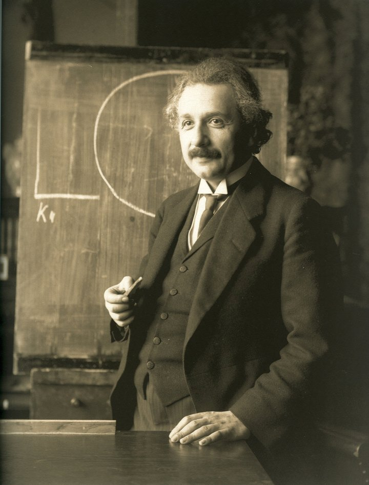

# Academic / Casual Template

An MIT-licensed Astro + Vue + TypeScript template for a research homepage and a separate Casual view. Both share Markdown, YAML, BibTeX and public assets from an independent content directory.

- `/`: a plain Academic homepage.
- `/casual/`: projects, interests and personal writing.
- Shared detail pages with stable paths and optional `?mode=casual` context.
- Static HTML, local search, project filters, bibliography export, dark mode and optional Giscus.
- Optional photos, portfolios and integrations; no developer accounts or blog required.

The bundled example is a sourced historical profile of **Albert Einstein**: research, publications, biography, music and correspondence. It uses a real public-domain photograph by Ferdinand Schmutzer (1921), with [source and image credits](examples/einstein/ASSETS.md). A site's own content belongs in a separate repository.

## Live demo

[Academic preview](https://zzxzzk115.github.io/academic-casual-template/) · [Casual preview](https://zzxzzk115.github.io/academic-casual-template/casual/)

The demo presents Einstein’s research, selected papers, biography and interests. The 1921 portrait is a historical photograph, not generated artwork. Switch presentation mode and color theme independently, or try the research filters and local search.

<a href="https://commons.wikimedia.org/wiki/File:Einstein_1921_by_F_Schmutzer.jpg"></a>

Photograph used in the example: Ferdinand Schmutzer, 1921. [Source and public-domain status](https://commons.wikimedia.org/wiki/File:Einstein_1921_by_F_Schmutzer.jpg). No generated illustrations are used.

## Quick start

Use Node **24** (minimum 22.22) and **pnpm 10.34.5**.

```sh
git clone https://github.com/zzxzzk115/academic-casual-template.git
cd academic-casual-template
pnpm install --frozen-lockfile
pnpm site dev
```

The default content is `examples/einstein`. Production builds include the Pagefind search index:

```sh
pnpm site build
pnpm site preview
```

## Start a separate content repository

```sh
pnpm site init --content ../my-homepage
pnpm site dev --content ../my-homepage
pnpm site build --content ../my-homepage --out ../my-homepage/dist
node scripts/verify.mjs ../my-homepage/dist ../my-homepage
```

`init` requires a new or empty directory. It copies the Einstein starter, adds a content README and `.gitignore`, and writes `template.lock.json` with the current template commit. It does not create a Git repository or deploy anything. Replace the historical example records, initialize your own content repository, and commit its configuration and assets.

Content paths are relative to the directory where you run the command. `--port 4321` is available for dev/preview. The template checkout must be at the revision recorded by the content repository; the CLI does not switch Git revisions automatically.

## Structure

```text
src/lib/schema.ts       Typed content/configuration contract
src/lib/content.ts      Content loading, references and routes
src/lib/markdown.ts     Markdown, highlighting and diagrams
src/layouts/            Shared document and navigation
src/components/         Homepage sections and optional Vue graphics
src/pages/              Static routes, feeds and metadata
src/scripts/            Progressive client-side interactions
scripts/                CLI, initialization and verification
examples/einstein/       Standalone historical example content site
```

Customize identity, mode sections, navigation, section titles, category labels, project selections and colors through site configuration. Update personal copy and tool preferences through content files. Template upgrades use an explicit commit pin; no npm package publication is needed.

- [Content and configuration](docs/content.md)
- [GitHub integration and deployment](docs/github.md)
- [Migrating a Jekyll/al-folio site](docs/migration.md)
- [Validation notes](QA.md)

## Validate

```sh
pnpm check
pnpm test
pnpm check:examples
```

The last command builds two independent fixtures at `/` and `/portfolio/`, checks links/resources, and checks that configured identities do not leak between builds. GitHub Actions runs these checks for pushes and pull requests. Successful runs on this upstream repository's `main` branch also deploy the Einstein Pages demo. Other repositories and pull requests only run validation.

English UI is provided. `site.language` sets the document language; it does not translate interface copy. Markdown HTML is trusted build input. Third-party fonts and libraries retain their own licenses; Font Awesome Free assets and license are bundled locally.
